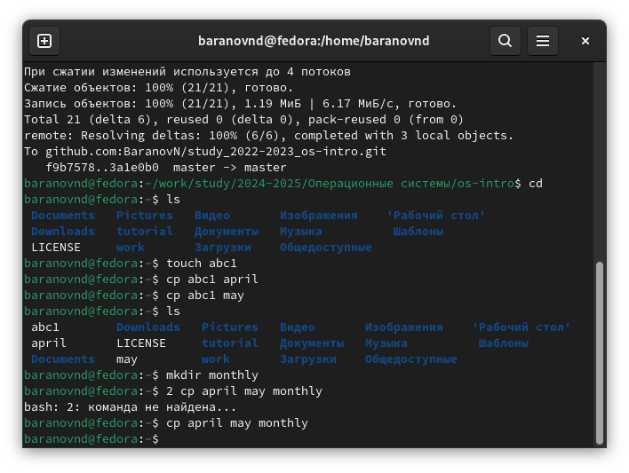
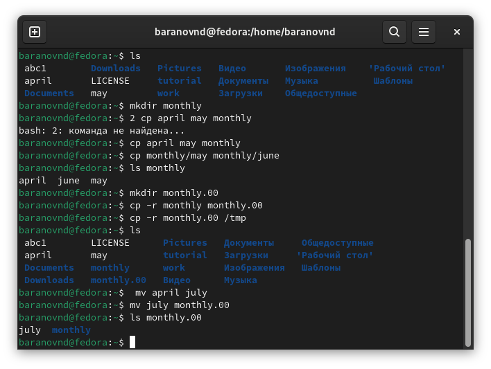
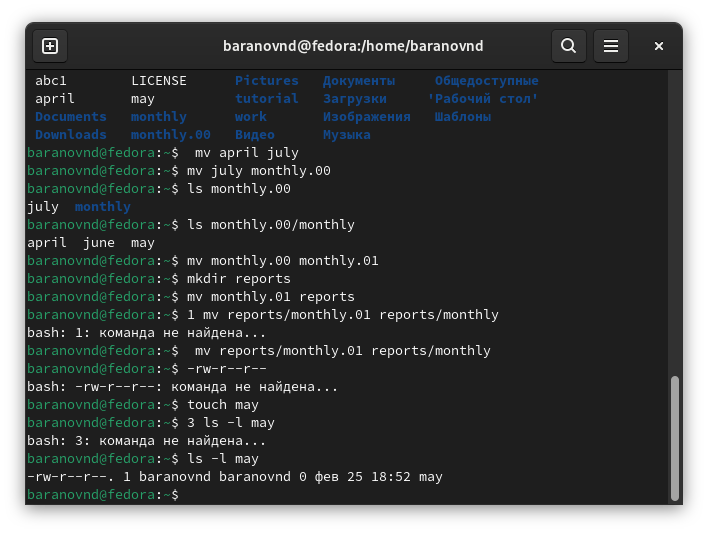
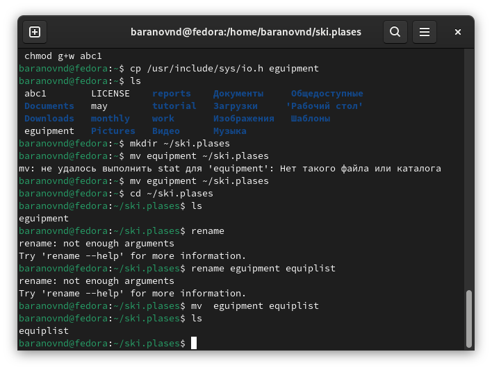
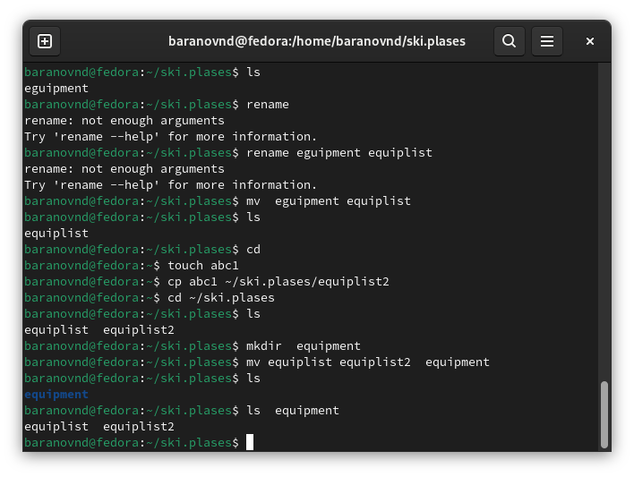
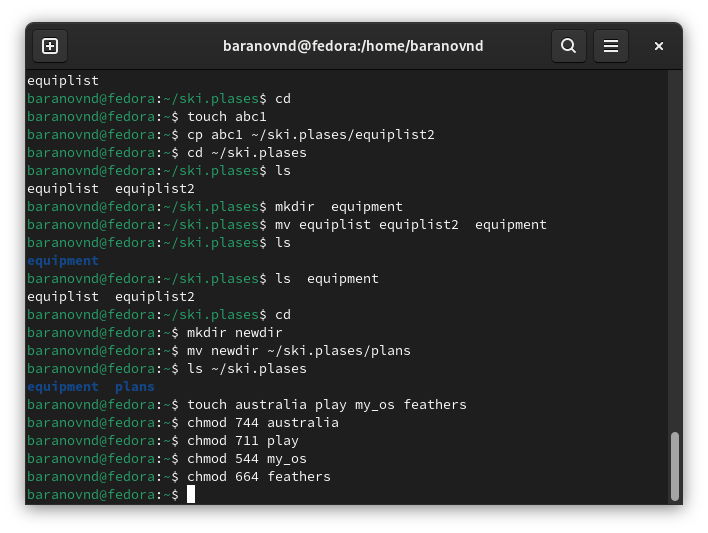
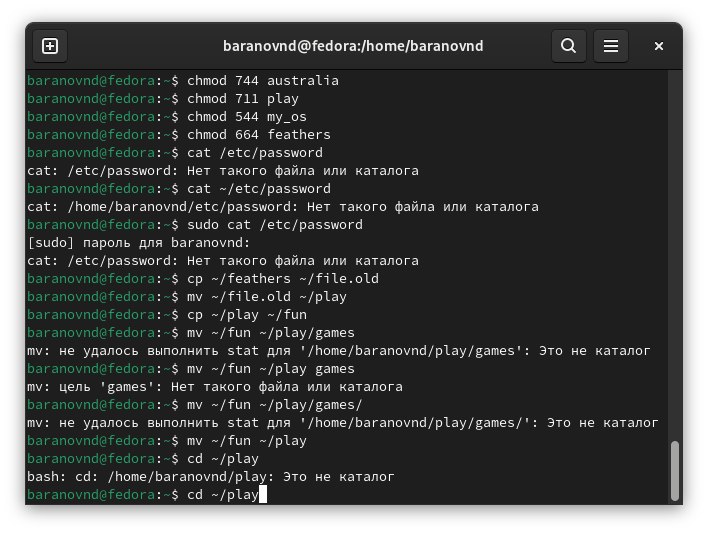
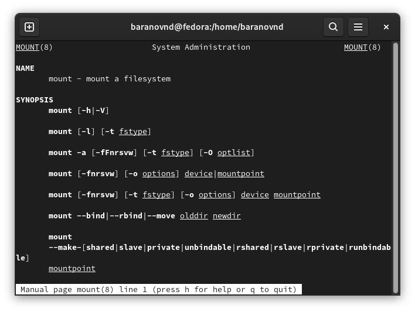

---
## Front matter
lang: ru-RU
title: Лабораторная работа №7
subtitle: Анализ файловой системы Linux.Команды для работы с файлами и каталогами
author:
  - Баранов Н.Д
institute:
  - Российский университет дружбы народов, Москва, Россия

## i18n babel
babel-lang: russian
babel-otherlangs: english

## Formatting pdf
toc: false
toc-title: Содержание
slide_level: 2
aspectratio: 169
section-titles: true
theme: metropolis
header-includes:
 - \metroset{progressbar=frametitle,sectionpage=progressbar,numbering=fraction}
---

# Информация

## Докладчик

:::::::::::::: {.columns align=center}
::: {.column width="70%"}

  * Баранов Никита Дмитриевич
  * студент
  * Российский университет дружбы народов
  * [1132242977@pfur.ru](mailto:1132242977@pfur.ru)
  
:::
::: {.column width="30%"}

:::
::::::::::::::

# Выполнение лабораторной работы

## Выполняем все примеры

:::::::::::::: {.columns align=center}
::: {.column width="30%"}

:::
::::::::::::::

## Выполняем все примеры

:::::::::::::: {.columns align=center}
::: {.column width="30%"}

:::
::::::::::::::

## Выполняем все примеры

:::::::::::::: {.columns align=center}
::: {.column width="30%"}

:::
::::::::::::::

## Выполняем пункт номер 2 задания

:::::::::::::: {.columns align=center}
::: {.column width="30%"}

:::
::::::::::::::

## Выполняем пункт номер 2 задания

:::::::::::::: {.columns align=center}
::: {.column width="30%"}

:::
::::::::::::::

## Выполняем пункт номер 2 задания

:::::::::::::: {.columns align=center}
::: {.column width="30%"}

:::
::::::::::::::

## Меняем права доступа к файлам

:::::::::::::: {.columns align=center}
::: {.column width="30%"}

:::
::::::::::::::

## Выполняем пункт номер 4 задания

:::::::::::::: {.columns align=center}
::: {.column width="30%"}

:::
::::::::::::::

## С помощью man просматриваем ключи команд

:::::::::::::: {.columns align=center}
::: {.column width="30%"}

:::
::::::::::::::

## Вывод

- Мы ознакомились с файловой системой Linux, её структурой, именами и содержанием
каталогов. Приобретение практических навыков по применению команд для работы
с файлами и каталогами, по управлению процессами (и работами), по проверке использования диска и обслуживанию файловой системы.

