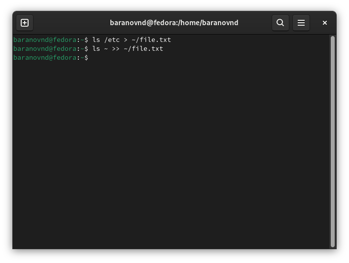
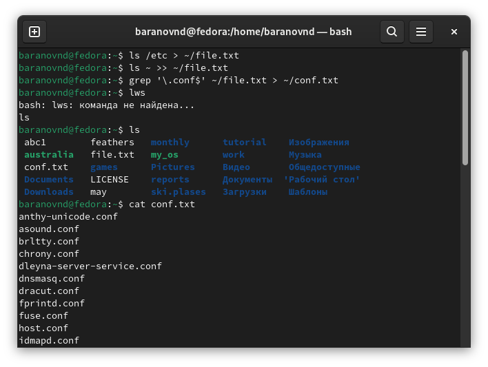
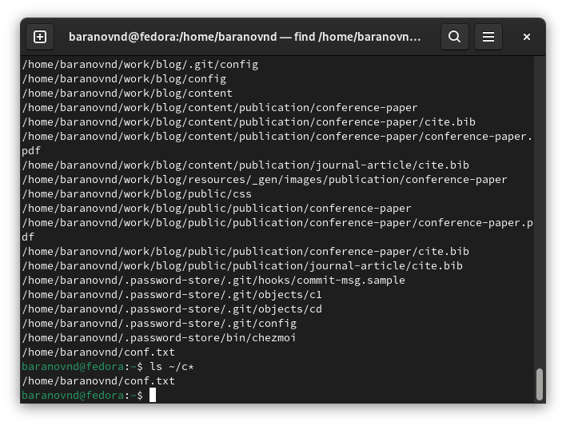
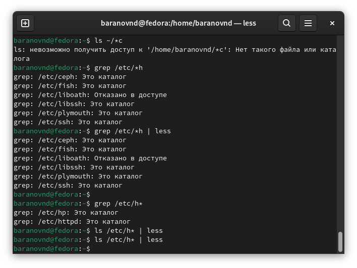
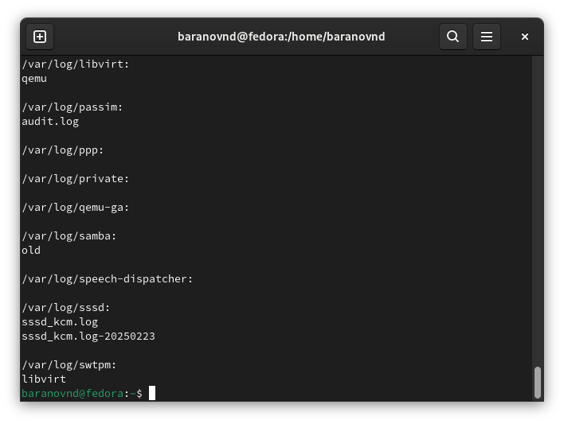
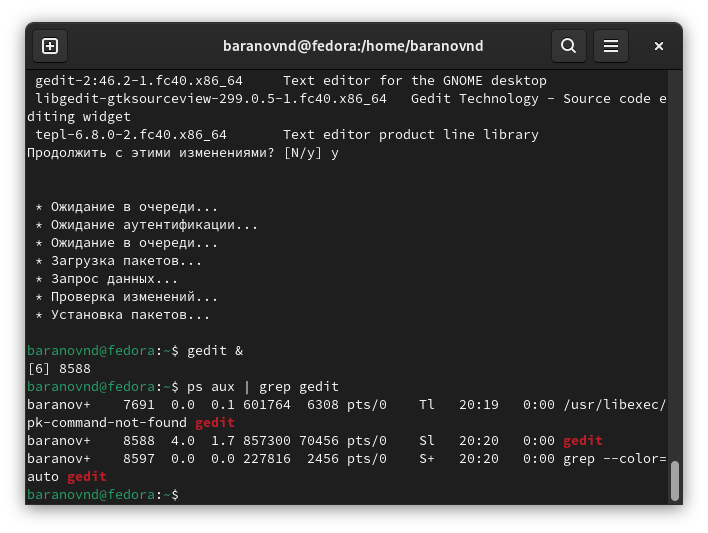
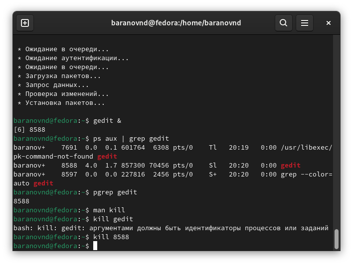
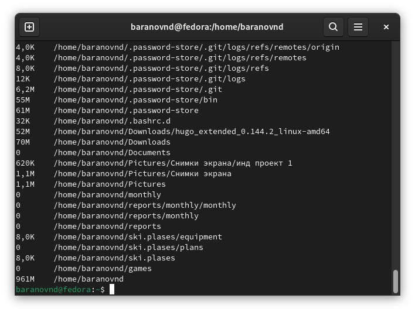

---
## Front matter
lang: ru-RU
title: Лабораторная работа №8
subtitle: Поиск файлов. Перенаправление ввода-вывода. Просмотр запущенных процессов
author:
  - Баранов Н.Д
institute:
  - Российский университет дружбы народов, Москва, Россия

## i18n babel
babel-lang: russian
babel-otherlangs: english

## Formatting pdf
toc: false
toc-title: Содержание
slide_level: 2
aspectratio: 169
section-titles: true
theme: metropolis
header-includes:
 - \metroset{progressbar=frametitle,sectionpage=progressbar,numbering=fraction}
---

# Информация

## Докладчик

:::::::::::::: {.columns align=center}
::: {.column width="70%"}

  * Баранов Никита Дмитриевич
  * студент
  * Российский университет дружбы народов
  * [1132242977@pfur.ru](mailto:1132242977@pfur.ru)
  
:::
::: {.column width="30%"}

:::
::::::::::::::

# Выполнение лабораторной работы

## Записываем в file.txt

:::::::::::::: {.columns align=center}
::: {.column width="30%"}

:::
::::::::::::::

## Выводим имена всех файлов, имеющих расширение conf

:::::::::::::: {.columns align=center}
::: {.column width="30%"}

:::
::::::::::::::

## Определяем какие файлы имеют c в начале

:::::::::::::: {.columns align=center}
::: {.column width="30%"}

:::
::::::::::::::

## Выводим постранично начинающиеся на h

:::::::::::::: {.columns align=center}
::: {.column width="30%"}

:::
::::::::::::::

## Запускаем в фоновом режиме процесс, записывающий в файл начинающиеся на log

:::::::::::::: {.columns align=center}
::: {.column width="30%"}

:::
::::::::::::::

## Запускаем в фоновом режиме gedit

:::::::::::::: {.columns align=center}
::: {.column width="30%"}

:::
::::::::::::::

## Закрываем Gedit

:::::::::::::: {.columns align=center}
::: {.column width="30%"}

:::
::::::::::::::

## Выполняем df and du

:::::::::::::: {.columns align=center}
::: {.column width="30%"}

:::
::::::::::::::

## Вывод

Мы ознакомились с инструментами поиска файлов и фильтрации текстовых данных.
Приобретение практических навыков: по управлению процессами (и заданиями), по
проверке использования диска и обслуживанию файловых систем.
