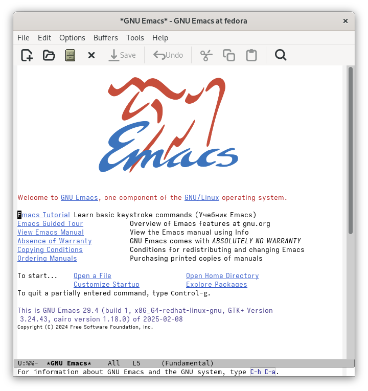
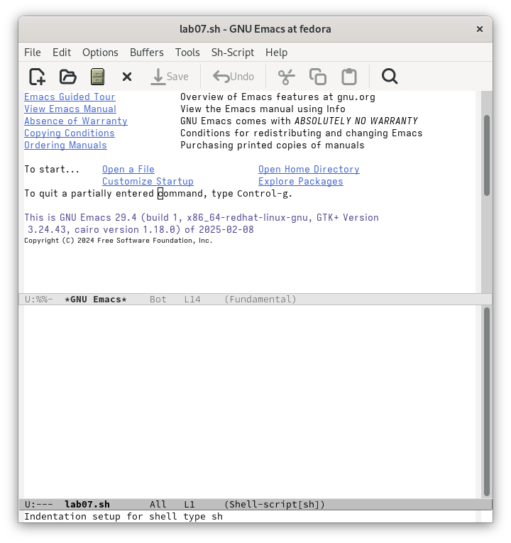
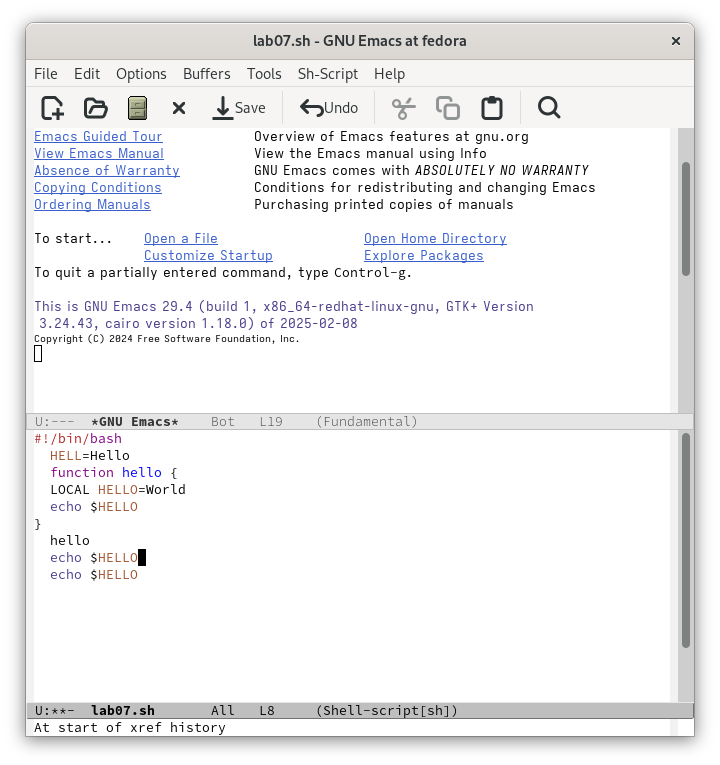
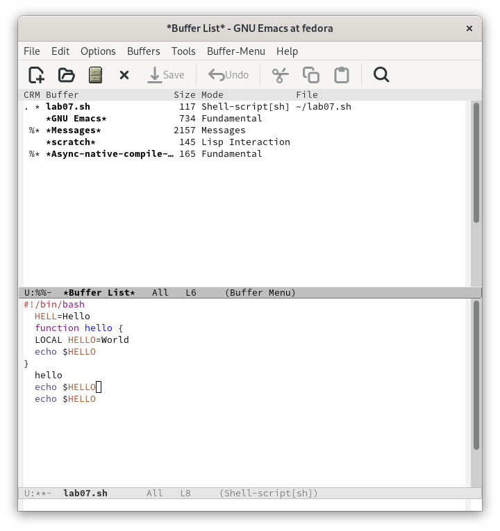
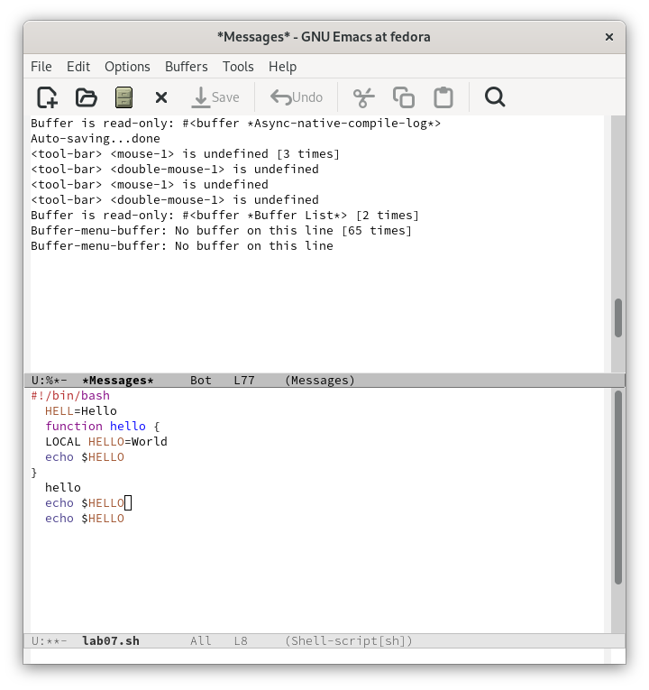
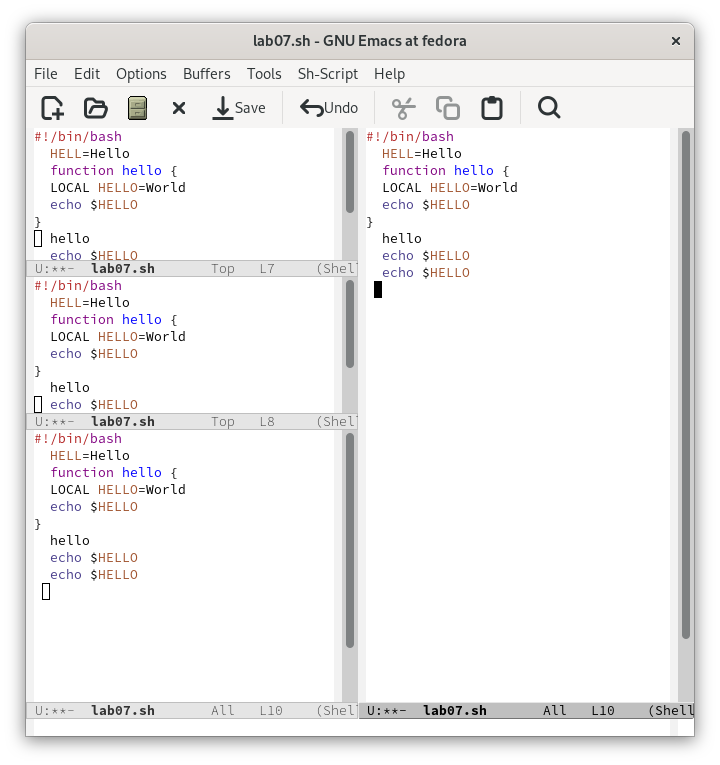
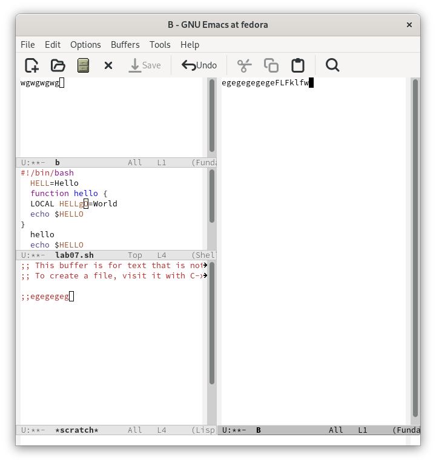
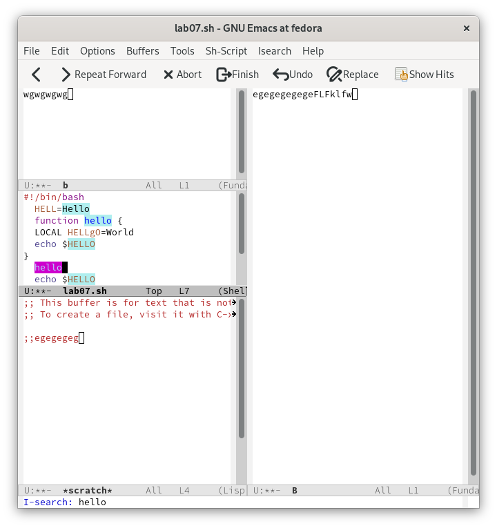
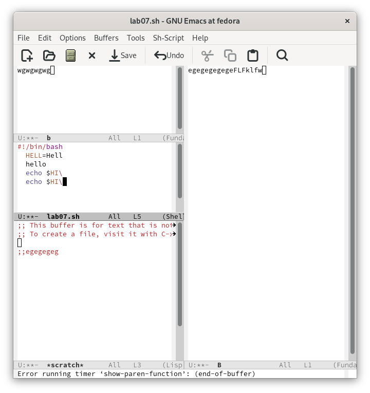
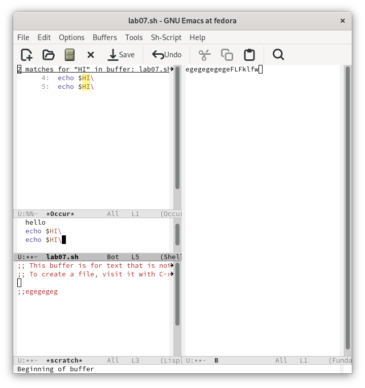

---
## Front matter
lang: ru-RU
title: Лабораторная работа № 11
subtitle: Текстовой редактор emacs
author:
  - Баранов Н.Д
institute:
  - Российский университет дружбы народов, Москва, Россия

## i18n babel
babel-lang: russian
babel-otherlangs: english

## Formatting pdf
toc: false
toc-title: Содержание
slide_level: 2
aspectratio: 169
section-titles: true
theme: metropolis
header-includes:
 - \metroset{progressbar=frametitle,sectionpage=progressbar,numbering=fraction}
---

# Информация

## Докладчик

:::::::::::::: {.columns align=center}
::: {.column width="70%"}

  * Баранов Никита Дмитриевич
  * студент
  * Российский университет дружбы народов
  * [1132242977@pfur.ru](mailto:1132242977@pfur.ru)
  
:::
::: {.column width="30%"}

:::
::::::::::::::

# Выполнение лабораторной работы

## Открываем emacs

:::::::::::::: {.columns align=center}
::: {.column width="30%"}

:::
::::::::::::::

## Создаем файл

:::::::::::::: {.columns align=center}
::: {.column width="30%"}

:::
::::::::::::::

## Редактируем файл

:::::::::::::: {.columns align=center}
::: {.column width="30%"}

:::
::::::::::::::

## Сохраняем файл

:::::::::::::: {.columns align=center}
::: {.column width="30%"}

:::
::::::::::::::

## Управляем буферами

:::::::::::::: {.columns align=center}
::: {.column width="30%"}

:::
::::::::::::::

## Управляем буферами

:::::::::::::: {.columns align=center}
::: {.column width="30%"}

:::
::::::::::::::

## Делим фрейм на 4 части

:::::::::::::: {.columns align=center}
::: {.column width="30%"}

:::
::::::::::::::

## В каждом окне создаем новый файл и редактируем
:::::::::::::: {.columns align=center}
::: {.column width="30%"}

:::
::::::::::::::

## В режиме поиска находим слова

:::::::::::::: {.columns align=center}
::: {.column width="30%"}

:::
::::::::::::::

## Заменяем Hello на HI

:::::::::::::: {.columns align=center}
::: {.column width="30%"}

:::
::::::::::::::

## Сравниваем с другим режимом поиска

:::::::::::::: {.columns align=center}
::: {.column width="30%"}

:::
::::::::::::::

## Вывод

- Мы познакомились с операционной системой Linux. Получили практические навыки работы с редактором Emacs.

