---
## Front matter
lang: ru-RU
title: Курс на степике
subtitle: Первый этап
author:
  - Баранов Н.Д
institute:
  - Российский университет дружбы народов, Москва, Россия

## i18n babel
babel-lang: russian
babel-otherlangs: english

## Formatting pdf
toc: false
toc-title: Содержание
slide_level: 2
aspectratio: 169
section-titles: true
theme: metropolis
header-includes:
 - \metroset{progressbar=frametitle,sectionpage=progressbar,numbering=fraction}
---

# Информация

## Докладчик

:::::::::::::: {.columns align=center}
::: {.column width="70%"}

  * Баранов Никита Дмитриевич
  * студент
  * Российский университет дружбы народов
  * [1132242977@pfur.ru](mailto:1132242977@pfur.ru)
  
:::
::: {.column width="30%"}

:::
::::::::::::::

# Выполнение лабораторной работы

## 1 вопрос

:::::::::::::: {.columns align=center}
::: {.column width="30%"}

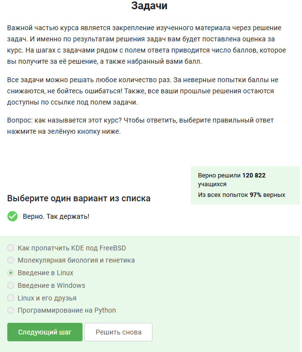

:::
::::::::::::::

## 2 вопрос

:::::::::::::: {.columns align=center}
::: {.column width="30%"}

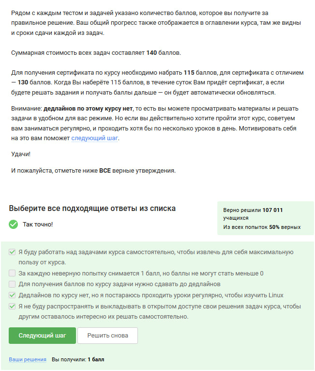

:::
::::::::::::::

# Презентация по тестовым заданиям

## Какую операционную систему вы обычно используете?

:::::::::::::: {.columns align=center}
::: {.column width="70%"}

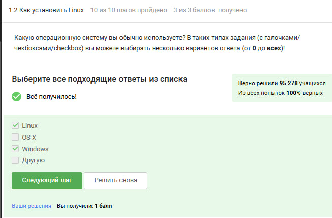{#fig:003}

:::
::::::::::::::

---

## Что такое виртуальная машина?

:::::::::::::: {.columns align=center}
::: {.column width="70%"}

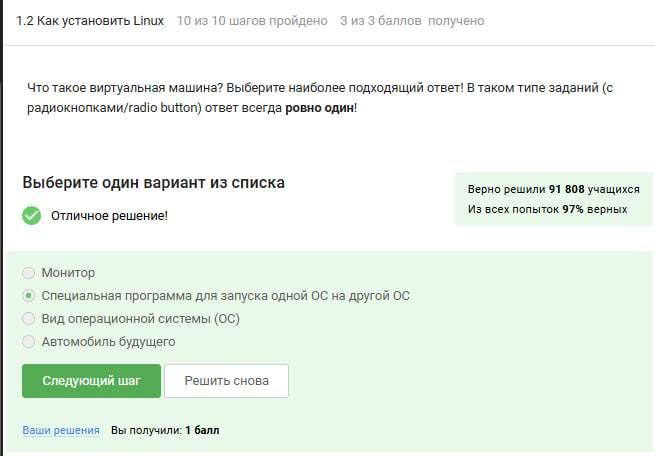{#fig:004}

:::
::::::::::::::

---

## Смогли ли вы запустить на своем компьютере Linux?

:::::::::::::: {.columns align=center}
::: {.column width="70%"}

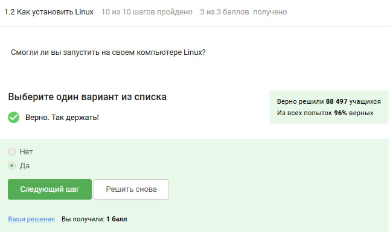{#fig:005}

:::
::::::::::::::

---

## Создание документа в LibreOffice Writer

:::::::::::::: {.columns align=center}
::: {.column width="70%"}

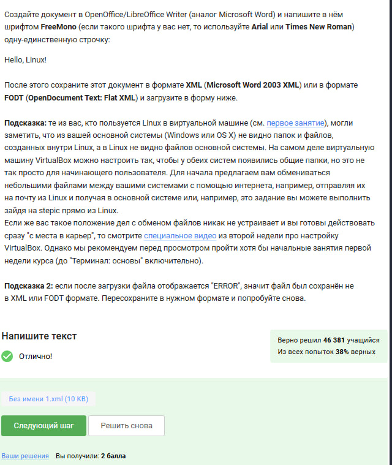{#fig:006}

:::
::::::::::::::

---

## Какое расширение имеют установочные пакеты в Linux?

:::::::::::::: {.columns align=center}
::: {.column width="70%"}

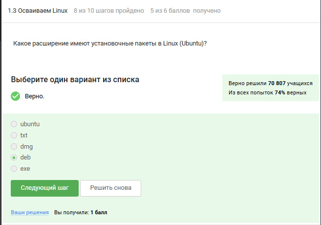{#fig:007}

:::
::::::::::::::

---

## Установка плеера VLC и информация об авторах

:::::::::::::: {.columns align=center}
::: {.column width="70%"}

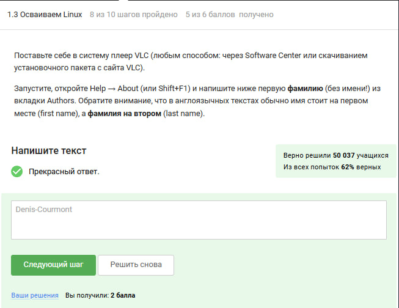{#fig:008}

:::
::::::::::::::

---

## Приложение Update Manager

:::::::::::::: {.columns align=center}
::: {.column width="70%"}

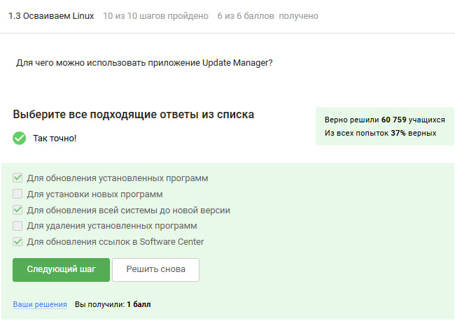{#fig:009}

:::
::::::::::::::

---

## Эквивалентные команды ls в терминале

:::::::::::::: {.columns align=center}
::: {.column width="70%"}

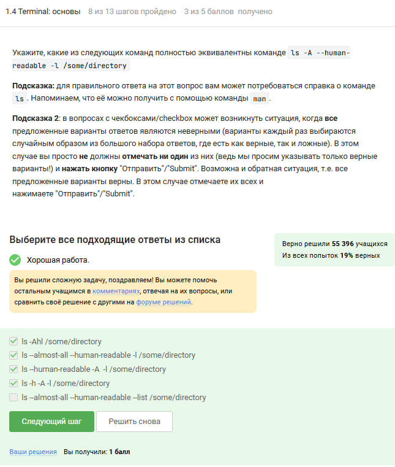{#fig:010}

:::
::::::::::::::

# Презентация по тестовым заданиям Linux

## Команды для вывода содержимого директории

:::::::::::::: {.columns align=center}
::: {.column width="70%"}

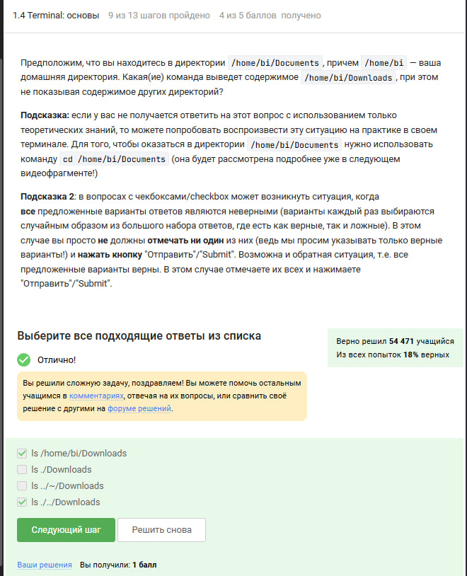{#fig:011}

:::
::::::::::::::

---

## Команда для удаления директорий

:::::::::::::: {.columns align=center}
::: {.column width="70%"}

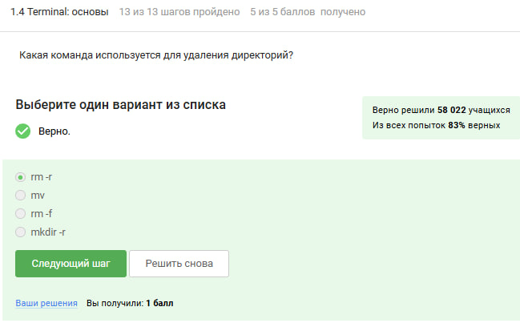{#fig:012}

:::
::::::::::::::

---

## Поведение терминала и Firefox

:::::::::::::: {.columns align=center}
::: {.column width="70%"}

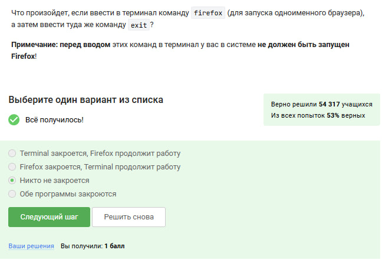{#fig:013}

:::
::::::::::::::

---

## Запуск программы с &

:::::::::::::: {.columns align=center}
::: {.column width="70%"}

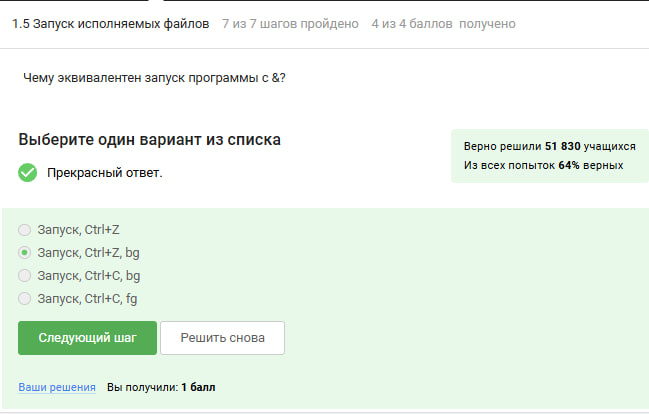{#fig:014}

:::
::::::::::::::

---

## Запуск исполняемого файла

:::::::::::::: {.columns align=center}
::: {.column width="70%"}

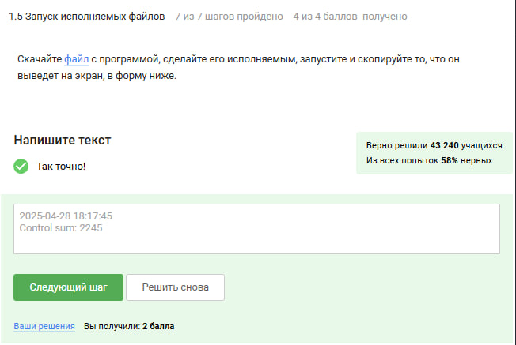{#fig:015}

:::
::::::::::::::

---

## Поток ошибок по умолчанию

:::::::::::::: {.columns align=center}
::: {.column width="70%"}

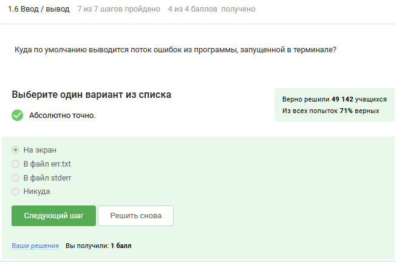{#fig:016}

:::
::::::::::::::

---

## Запись потока ошибок в файл

:::::::::::::: {.columns align=center}
::: {.column width="70%"}

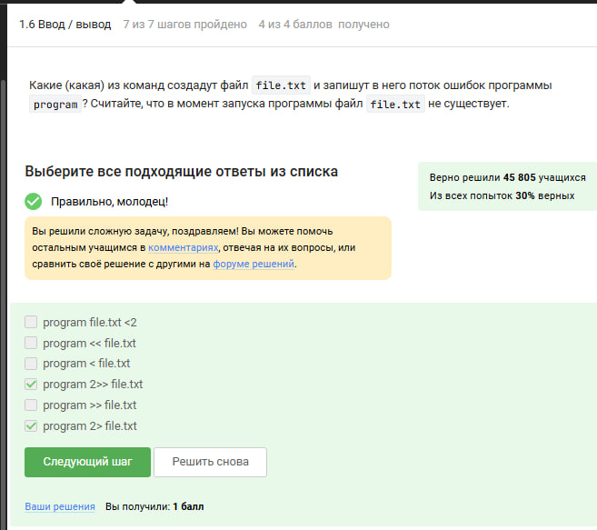{#fig:017}

:::
::::::::::::::

---

## Ошибки в конвейере

:::::::::::::: {.columns align=center}
::: {.column width="70%"}

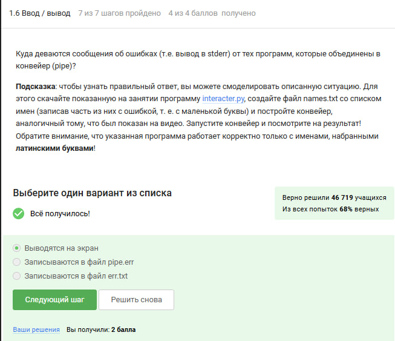{#fig:018}

:::
::::::::::::::

---

## Скачивание картинки с wget

:::::::::::::: {.columns align=center}
::: {.column width="70%"}

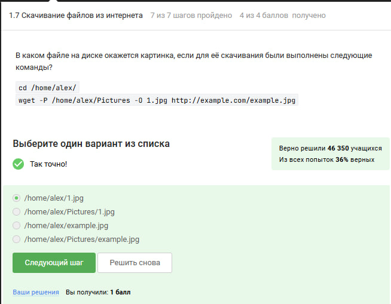{#fig:019}

:::
::::::::::::::

---

## Тихий режим wget

:::::::::::::: {.columns align=center}
::: {.column width="70%"}

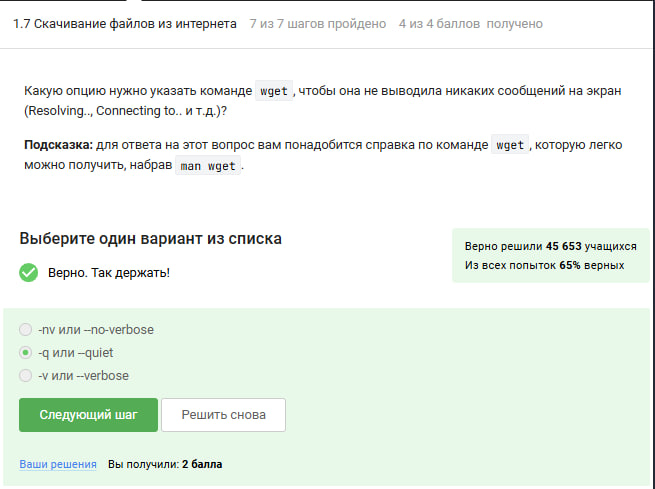{#fig:020}

:::
::::::::::::::

---

## Фильтрация скачиваний wget

:::::::::::::: {.columns align=center}
::: {.column width="70%"}

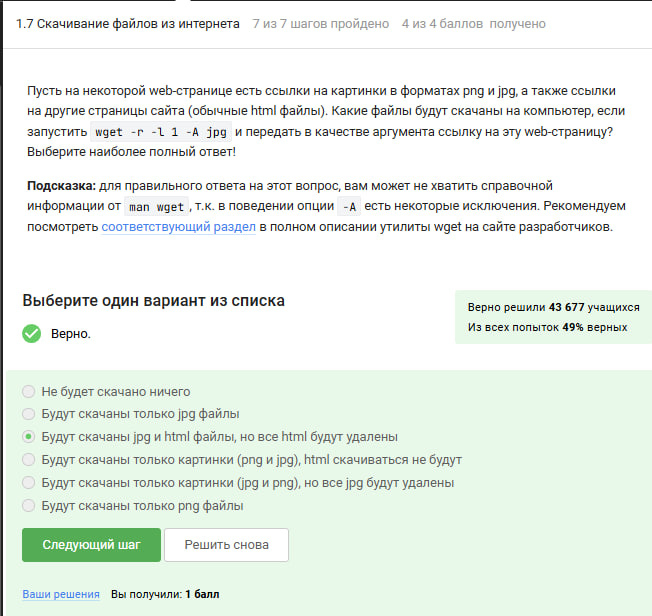{#fig:021}

:::
::::::::::::::

---

## Различия gzip и zip

:::::::::::::: {.columns align=center}
::: {.column width="70%"}

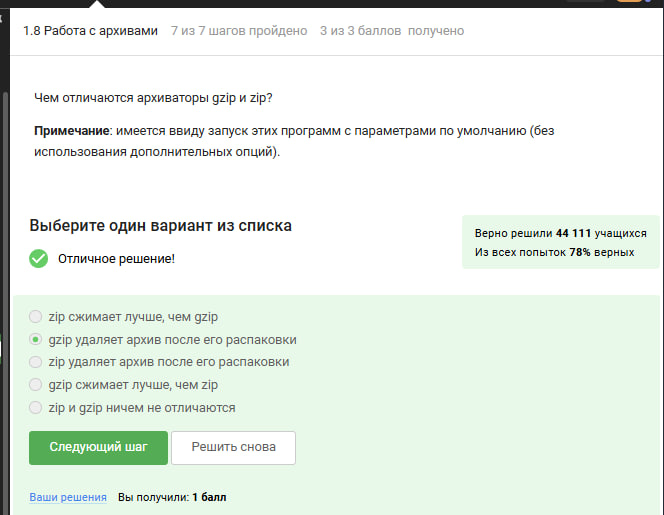{#fig:022}

:::
::::::::::::::

---

## Архиваторы для директорий

:::::::::::::: {.columns align=center}
::: {.column width="70%"}

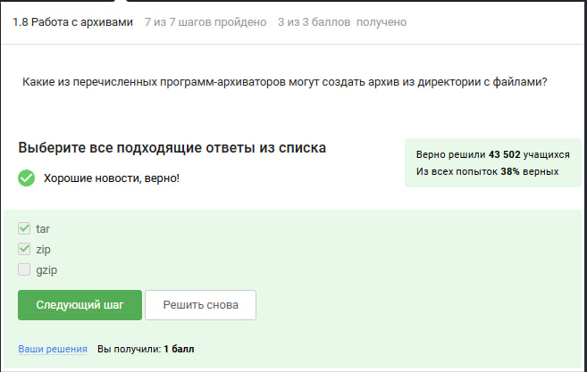{#fig:023}

:::
::::::::::::::

---

## Создание tar.bz2 архива

:::::::::::::: {.columns align=center}
::: {.column width="70%"}

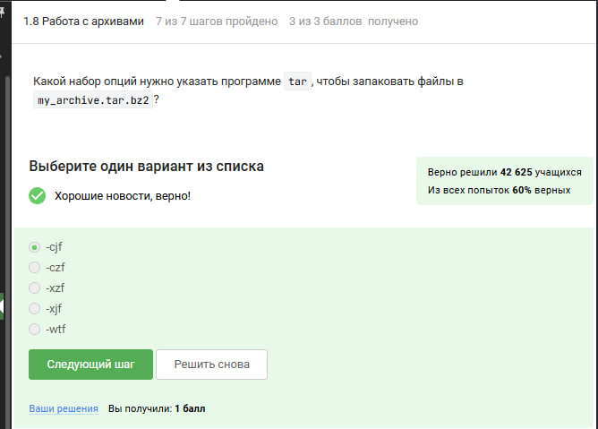{#fig:024}

:::
::::::::::::::

---

## Поэтическое задание

:::::::::::::: {.columns align=center}
::: {.column width="70%"}

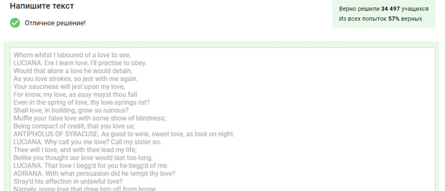{#fig:025}

:::
::::::::::::::

## Вывод

- Мы успешно справились с выполнением первого этапа на степике!
