---
## Front matter
lang: ru-RU
title: Курс на степике
subtitle: 2 раздел
author:
  - Баранов Н.Д
institute:
  - Российский университет дружбы народов, Москва, Россия

## i18n babel
babel-lang: russian
babel-otherlangs: english

## Formatting pdf
toc: false
toc-title: Содержание
slide_level: 2
aspectratio: 169
section-titles: true
theme: metropolis
header-includes:
 - \metroset{progressbar=frametitle,sectionpage=progressbar,numbering=fraction}
---

# Информация

## Докладчик

:::::::::::::: {.columns align=center}
::: {.column width="70%"}

  * Баранов Никита Дмитриевич
  * студент
  * Российский университет дружбы народов
  * [1132242977@pfur.ru](mailto:1132242977@pfur.ru)
  
:::
::: {.column width="30%"}

:::
::::::::::::::

# Презентация по второму этапу курса Linux

## Раздел 2.1: Знакомство с сервером

### Использование удаленного сервера

:::::::::::::: {.columns align=center}
::: {.column width="70%"}

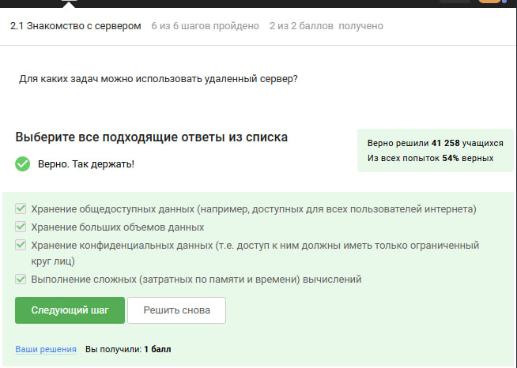{#fig:201}

:::
::::::::::::::

---

### Безопасная передача SSH-ключей

:::::::::::::: {.columns align=center}
::: {.column width="70%"}

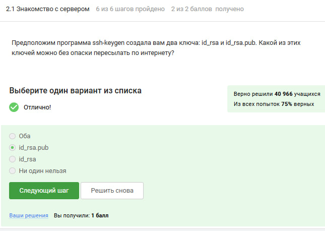{#fig:202}

:::
::::::::::::::

---

## Раздел 2.2: Обмен файлами

### Копирование папки на сервер

:::::::::::::: {.columns align=center}
::: {.column width="70%"}

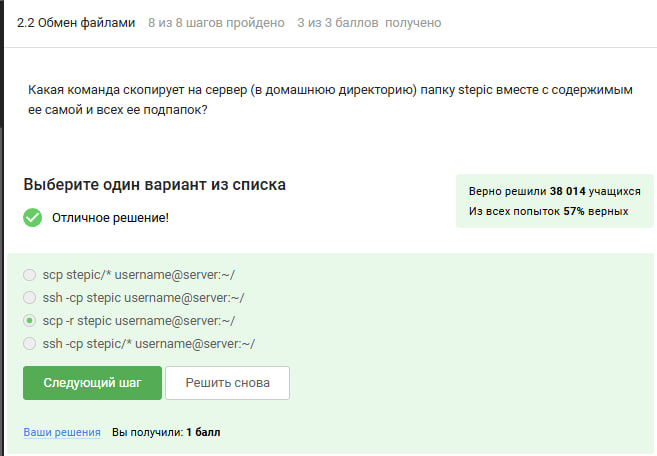{#fig:203}

:::
::::::::::::::

---

### Устранение проблем с пакетами

:::::::::::::: {.columns align=center}
::: {.column width="70%"}

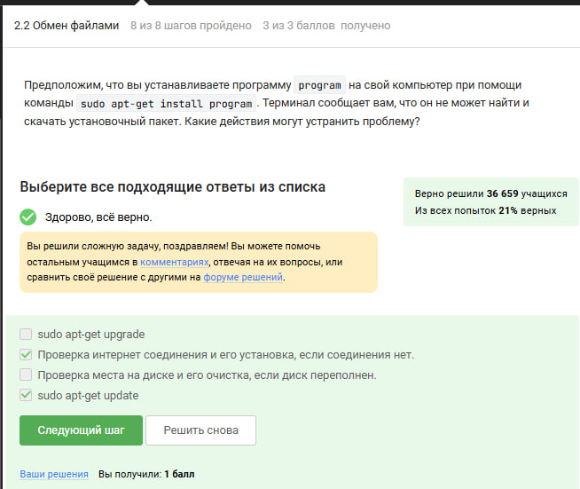{#fig:204}

:::
::::::::::::::

---

### Функции FileZilla

:::::::::::::: {.columns align=center}
::: {.column width="70%"}

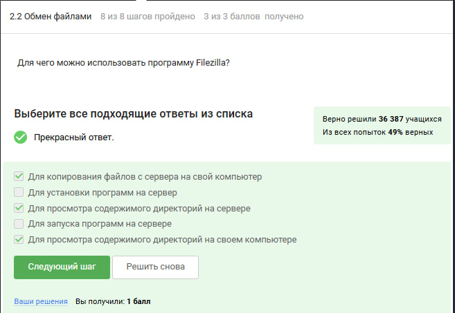{#fig:205}

:::
::::::::::::::

---

## Раздел 2.3: Запуск приложений

### Графические приложения на сервере

:::::::::::::: {.columns align=center}
::: {.column width="70%"}

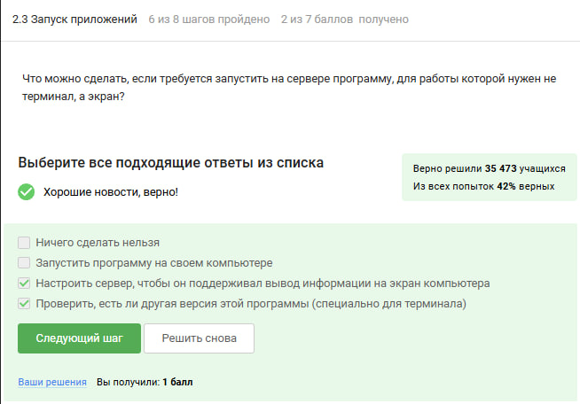{#fig:206}

:::
::::::::::::::

---

### Справочная информация

:::::::::::::: {.columns align=center}
::: {.column width="70%"}

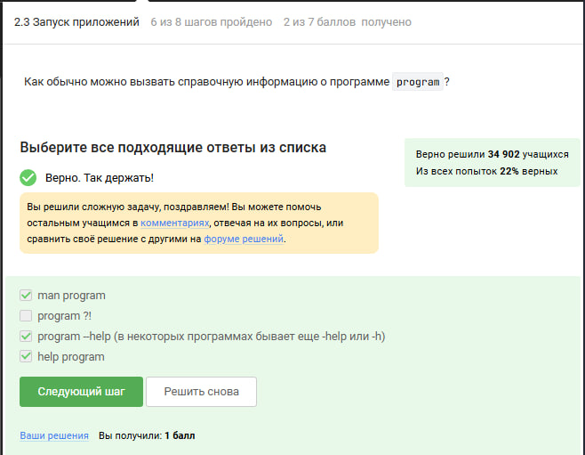{#fig:207}

:::
::::::::::::::

---

### Форматы файлов

:::::::::::::: {.columns align=center}
::: {.column width="70%"}

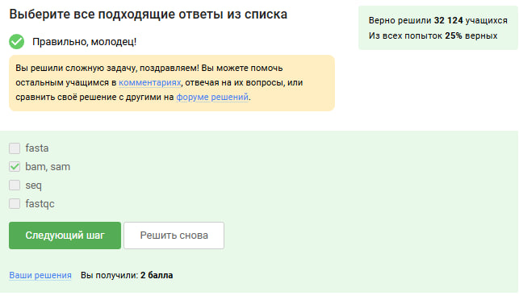{#fig:208}

:::
::::::::::::::

---

### Запись вывода bowtie

:::::::::::::: {.columns align=center}
::: {.column width="70%"}

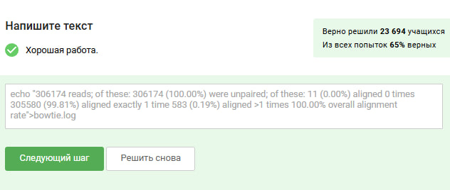{#fig:209}

:::
::::::::::::::

---

### Выбор инструмента bowtie

:::::::::::::: {.columns align=center}
::: {.column width="70%"}

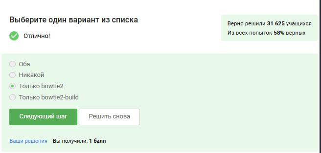{#fig:210}

:::
::::::::::::::

---

## Раздел 2.4: Контроль процессов

### Управление фоновыми программами

:::::::::::::: {.columns align=center}
::: {.column width="70%"}

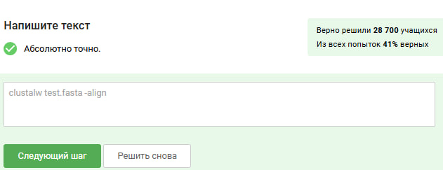{#fig:211}

:::
::::::::::::::

---

### Команда jobs

:::::::::::::: {.columns align=center}
::: {.column width="70%"}

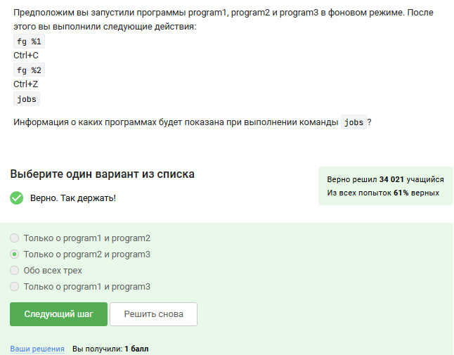{#fig:212}

:::
::::::::::::::

---

### Идентификаторы процессов

:::::::::::::: {.columns align=center}
::: {.column width="70%"}

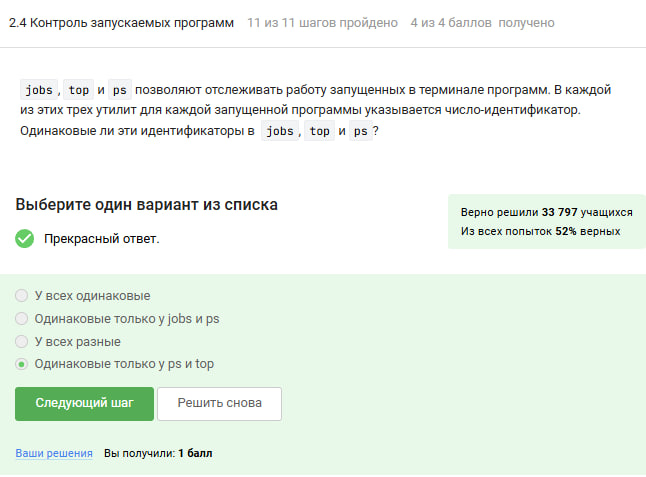{#fig:213}

:::
::::::::::::::

---

### Завершение процессов

:::::::::::::: {.columns align=center}
::: {.column width="70%"}

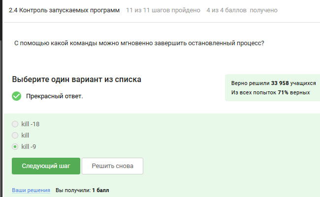{#fig:214}

:::
::::::::::::::

---

### Приостановленные процессы

:::::::::::::: {.columns align=center}
::: {.column width="70%"}

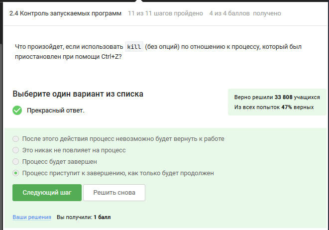{#fig:215}

:::
::::::::::::::

---

### Использование CPU

:::::::::::::: {.columns align=center}
::: {.column width="70%"}

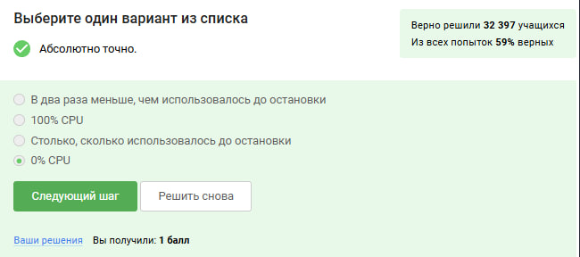{#fig:216}

:::
::::::::::::::

---

### Использование памяти

:::::::::::::: {.columns align=center}
::: {.column width="70%"}

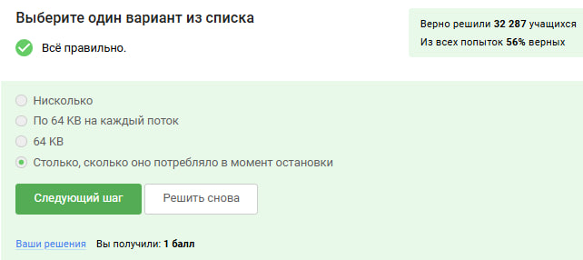{#fig:217}

:::
::::::::::::::

---

### Потоки процесса

:::::::::::::: {.columns align=center}
::: {.column width="70%"}

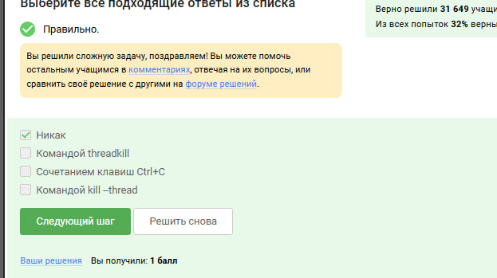{#fig:218}

:::
::::::::::::::

---

## Раздел 2.6: Работа с tmux

### Переименование вкладки

:::::::::::::: {.columns align=center}
::: {.column width="70%"}

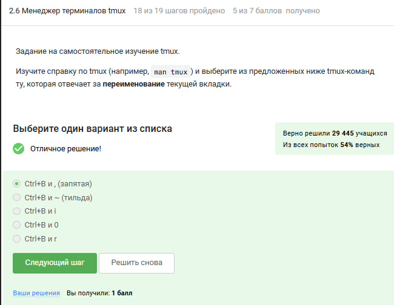{#fig:224}

:::
::::::::::::::

---

### Переключение между вкладками

:::::::::::::: {.columns align=center}
::: {.column width="70%"}

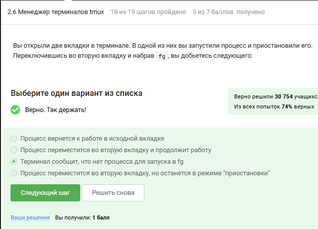{#fig:220}

:::
::::::::::::::

---

### Закрытие терминала

:::::::::::::: {.columns align=center}
::: {.column width="70%"}

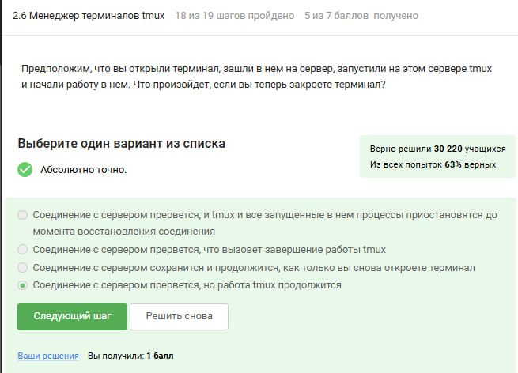{#fig:222}

:::
::::::::::::::

---

### Завершение последней вкладки

:::::::::::::: {.columns align=center}
::: {.column width="70%"}

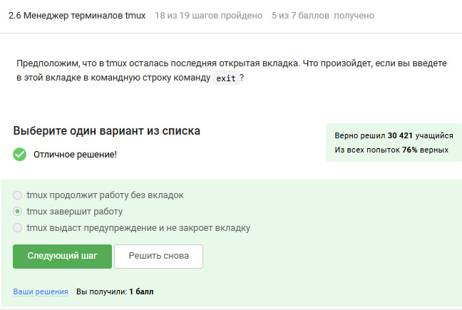{#fig:221}

:::
::::::::::::::

---

### Закрытие вкладки с процессом

:::::::::::::: {.columns align=center}
::: {.column width="70%"}

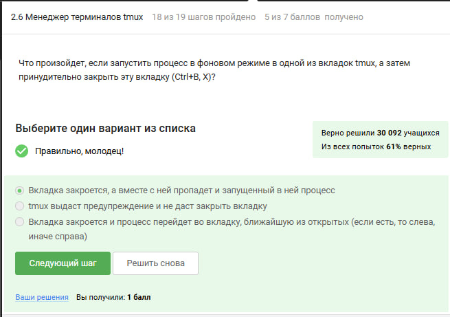{#fig:223}

:::
::::::::::::::

---

### Разделение экрана

:::::::::::::: {.columns align=center}
::: {.column width="70%"}

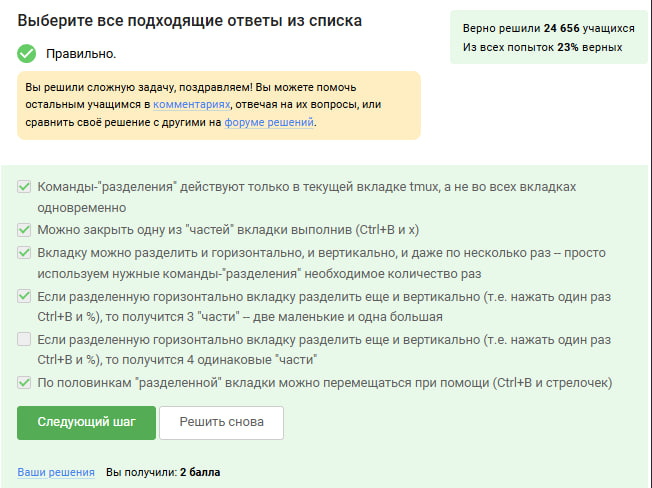{#fig:225}

:::
::::::::::::::

---

## Вывод

- Мы успешно прошли второй этап курса на степике
