---
## Front matter
lang: ru-RU
title: Прохождение курса на степике
subtitle: 3 раздел
author:
  - Баранов Н.Д
institute:
  - Российский университет дружбы народов, Москва, Россия

## i18n babel
babel-lang: russian
babel-otherlangs: english

## Formatting pdf
toc: false
toc-title: Содержание
slide_level: 2
aspectratio: 169
section-titles: true
theme: metropolis
header-includes:
 - \metroset{progressbar=frametitle,sectionpage=progressbar,numbering=fraction}
---

# Информация

## Докладчик

:::::::::::::: {.columns align=center}
::: {.column width="70%"}

  * Баранов Никита Дмитриевич
  * студент
  * Российский университет дружбы народов
  * [1132242977@pfur.ru](mailto:1132242977@pfur.ru)
  
:::
::: {.column width="30%"}

:::
::::::::::::::

# Выполнение раздела

## Раздел 1: Работа с Vim

### Выход из редактора Vim

:::::::::::::: {.columns align=center}
::: {.column width="70%"}

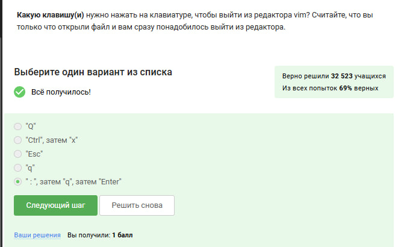{#fig:001}

:::
::::::::::::::

---

### Навигация по словам

:::::::::::::: {.columns align=center}
::: {.column width="70%"}

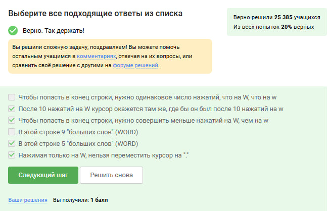{#fig:002}

:::
::::::::::::::

---

### Команды редактирования

:::::::::::::: {.columns align=center}
::: {.column width="70%"}

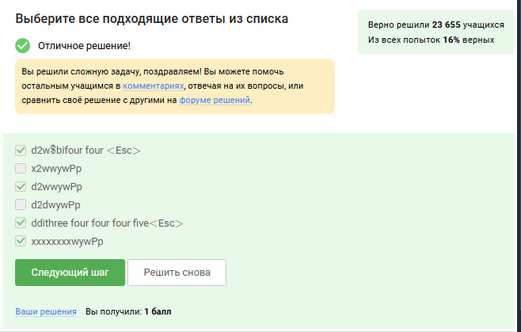{#fig:003}

:::
::::::::::::::

---

### Замена текста

:::::::::::::: {.columns align=center}
::: {.column width="70%"}

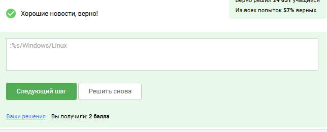{#fig:004}

:::
::::::::::::::

---

### Визуальный режим

:::::::::::::: {.columns align=center}
::: {.column width="70%"}

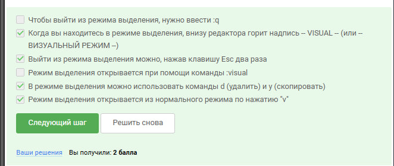{#fig:005}

:::
::::::::::::::

---

### Выбор файлов

:::::::::::::: {.columns align=center}
::: {.column width="70%"}

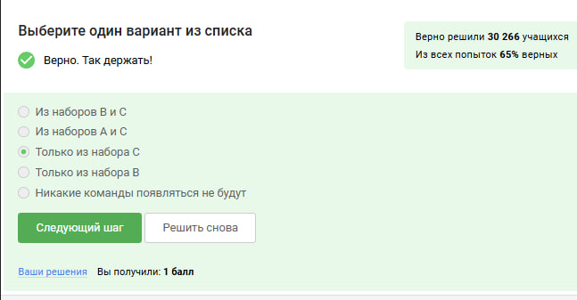{#fig:006}

:::
::::::::::::::

---

### Расположение файлов

:::::::::::::: {.columns align=center}
::: {.column width="70%"}

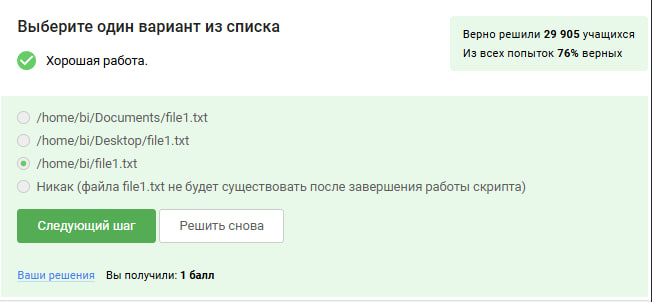{#fig:007}

:::
::::::::::::::

---

### Имена переменных

:::::::::::::: {.columns align=center}
::: {.column width="70%"}

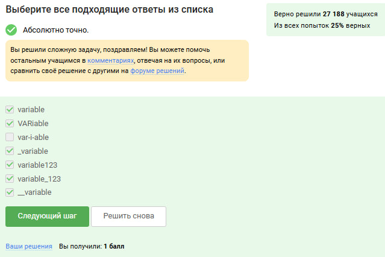{#fig:008}

:::
::::::::::::::

---

## Раздел 2: Основы Bash

### Аргументы скрипта

:::::::::::::: {.columns align=center}
::: {.column width="70%"}

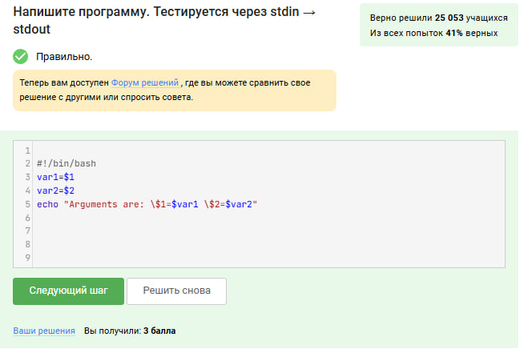{#fig:009}

:::
::::::::::::::

---

### Условные операторы

:::::::::::::: {.columns align=center}
::: {.column width="70%"}

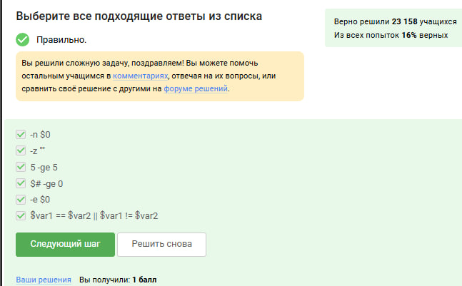{#fig:010}

:::
::::::::::::::

---

### Порядок выполнения

:::::::::::::: {.columns align=center}
::: {.column width="70%"}

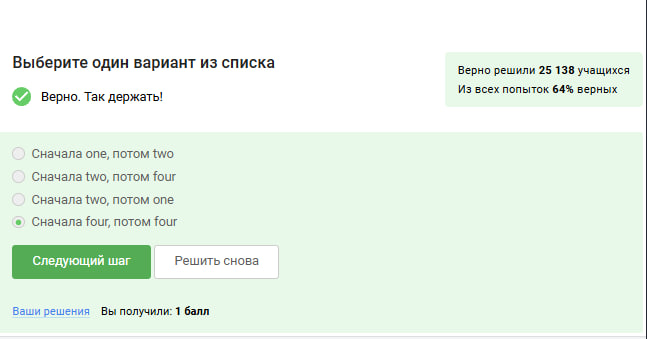{#fig:011}

:::
::::::::::::::

---

### Управление студентами

:::::::::::::: {.columns align=center}
::: {.column width="70%"}

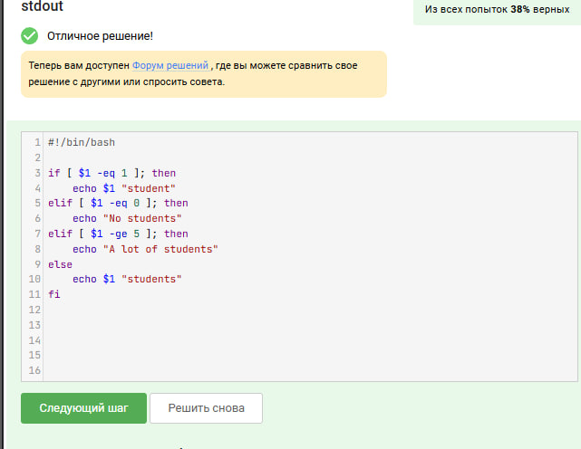{#fig:012}

:::
::::::::::::::

---

### Циклы в bash

:::::::::::::: {.columns align=center}
::: {.column width="70%"}

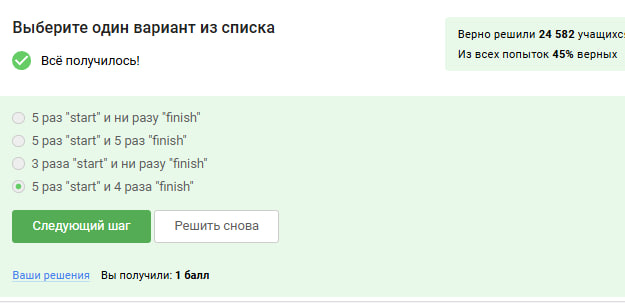{#fig:013}

:::
::::::::::::::

---

### Возрастные группы

:::::::::::::: {.columns align=center}
::: {.column width="70%"}

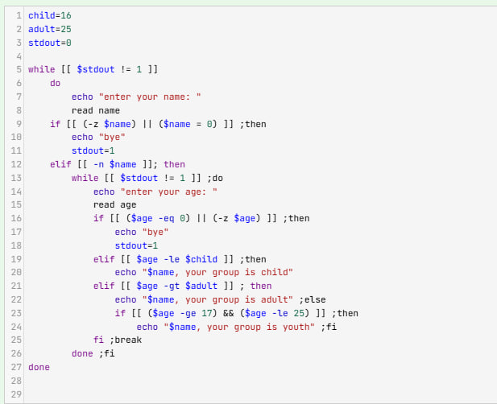{#fig:014}

:::
::::::::::::::

---

### Арифметические операции

:::::::::::::: {.columns align=center}
::: {.column width="70%"}

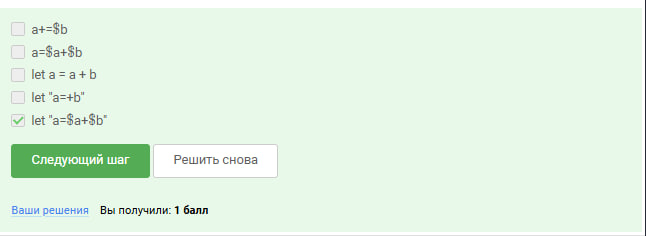{#fig:015}

:::
::::::::::::::

---

### Команда pwd

:::::::::::::: {.columns align=center}
::: {.column width="70%"}

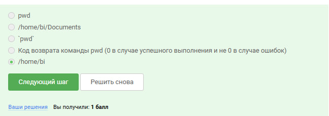{#fig:016}

:::
::::::::::::::

---

### Проверка выполнения

:::::::::::::: {.columns align=center}
::: {.column width="70%"}

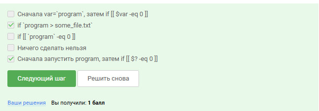{#fig:017}

:::
::::::::::::::

---

### Работа со счетчиком

:::::::::::::: {.columns align=center}
::: {.column width="70%"}

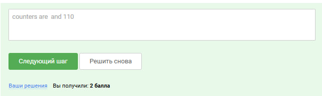{#fig:018}

:::
::::::::::::::

---

### Вычисление НОД

:::::::::::::: {.columns align=center}
::: {.column width="70%"}

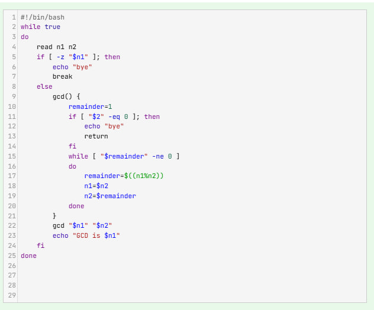{#fig:019}

:::
::::::::::::::

---

### Bash-калькулятор

:::::::::::::: {.columns align=center}
::: {.column width="70%"}

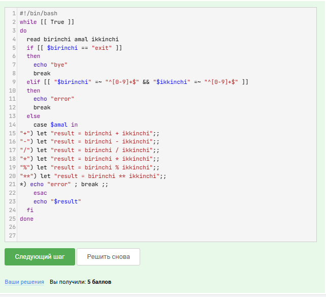{#fig:020}

:::
::::::::::::::

---

## Раздел 3: Работа с файлами

### Поиск по шаблону

:::::::::::::: {.columns align=center}
::: {.column width="70%"}

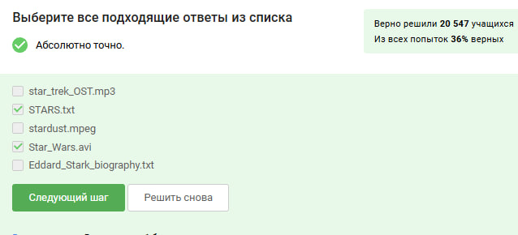{#fig:021}

:::
::::::::::::::

---

### Опции find

:::::::::::::: {.columns align=center}
::: {.column width="70%"}

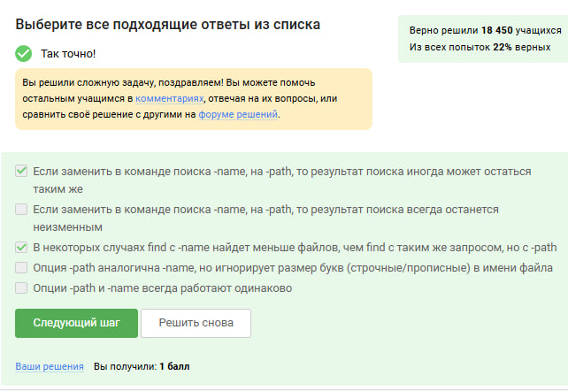{#fig:022}

:::
::::::::::::::

---

### Глубина поиска

:::::::::::::: {.columns align=center}
::: {.column width="70%"}

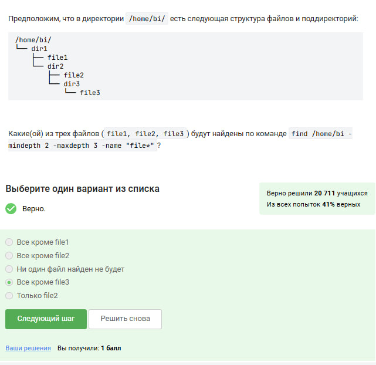{#fig:023}

:::
::::::::::::::

---

### Опции grep

:::::::::::::: {.columns align=center}
::: {.column width="70%"}

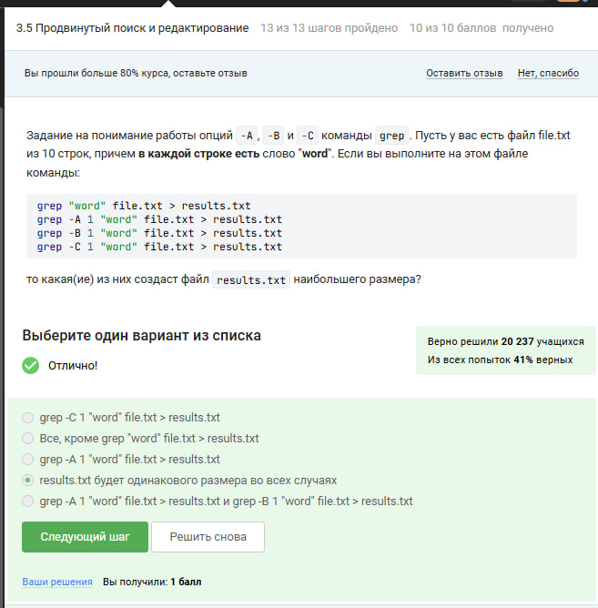{#fig:024}

:::
::::::::::::::

---

### Работа с sed

:::::::::::::: {.columns align=center}
::: {.column width="70%"}

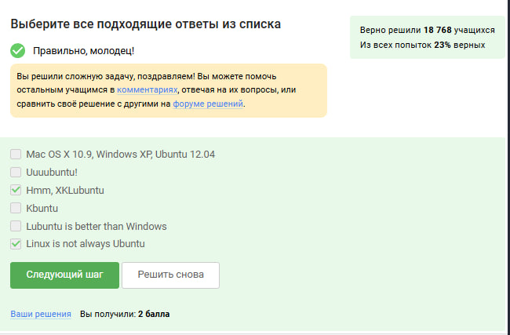{#fig:025}

:::
::::::::::::::

---

### Опция -n в sed

:::::::::::::: {.columns align=center}
::: {.column width="70%"}

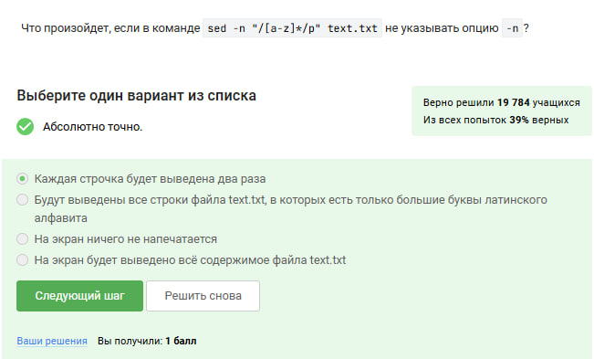{#fig:026}

:::
::::::::::::::

---

### Пример sed

:::::::::::::: {.columns align=center}
::: {.column width="70%"}

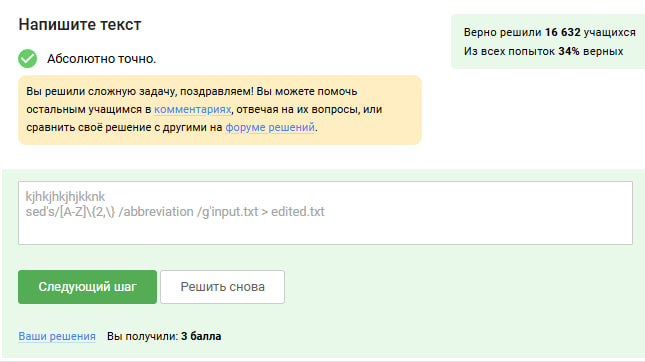{#fig:027}

:::
::::::::::::::

---

## Раздел 4: Продвинутые инструменты

### Настройка gnuplot

:::::::::::::: {.columns align=center}
::: {.column width="70%"}

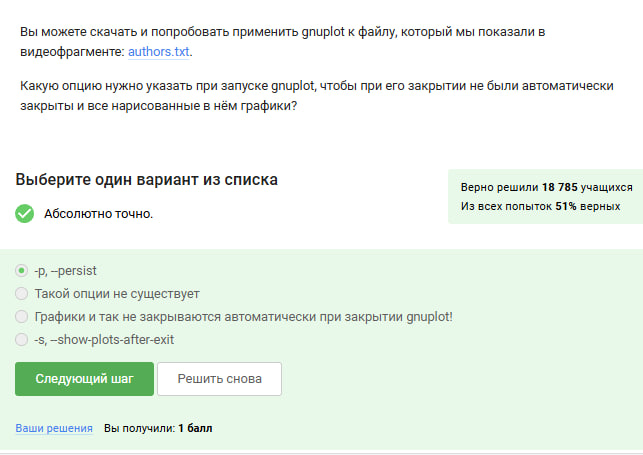{#fig:028}

:::
::::::::::::::

---

### Построение графиков

:::::::::::::: {.columns align=center}
::: {.column width="70%"}

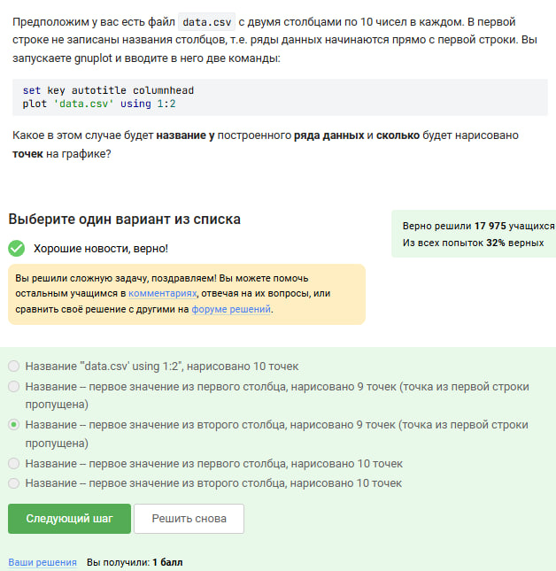{#fig:029}

:::
::::::::::::::

---

### Метки осей

:::::::::::::: {.columns align=center}
::: {.column width="70%"}

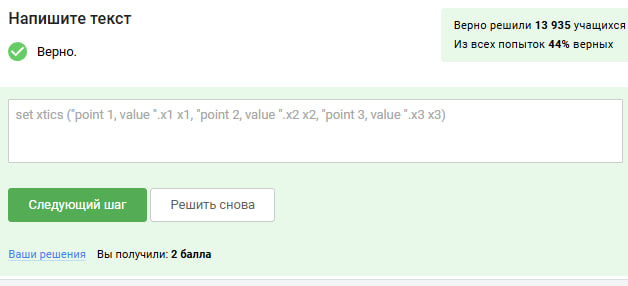{#fig:030}

:::
::::::::::::::

---

### Анимация

:::::::::::::: {.columns align=center}
::: {.column width="70%"}

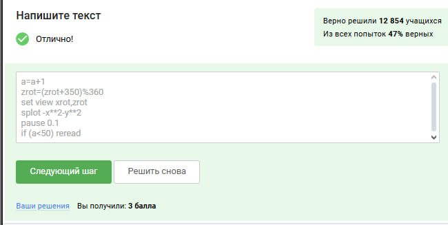{#fig:031}

:::
::::::::::::::

---

### Права доступа

:::::::::::::: {.columns align=center}
::: {.column width="70%"}

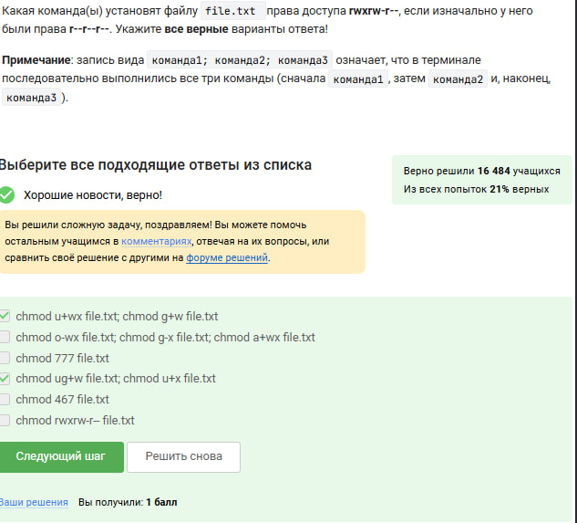{#fig:032}

:::
::::::::::::::

---

### Владельцы файлов

:::::::::::::: {.columns align=center}
::: {.column width="70%"}

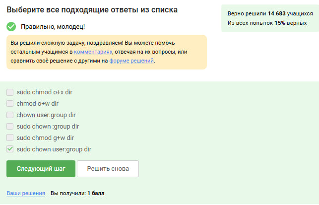{#fig:033}

:::
::::::::::::::

---

### Информация о файле

:::::::::::::: {.columns align=center}
::: {.column width="70%"}

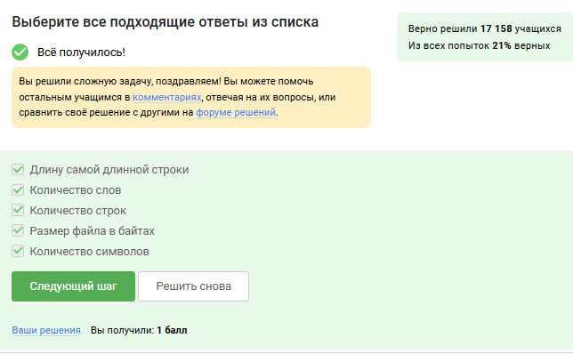{#fig:034}

:::
::::::::::::::

---

### Размер директории

:::::::::::::: {.columns align=center}
::: {.column width="70%"}

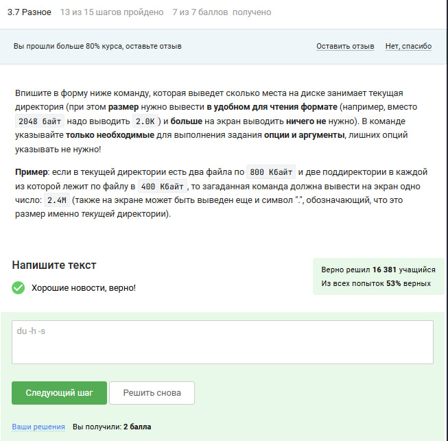{#fig:035}

:::
::::::::::::::

---

### Создание директорий

:::::::::::::: {.columns align=center}
::: {.column width="70%"}

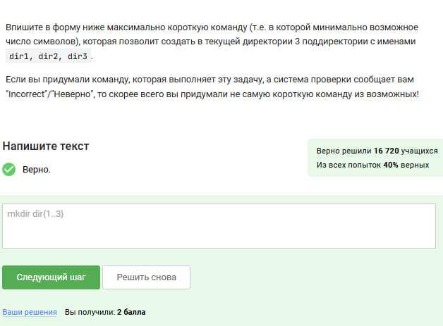{#fig:036}

:::
::::::::::::::

---

## Вывод

- Мы приобрели практические навыки по установке ОС на ВМ, а также настройке необходимых сервисов

